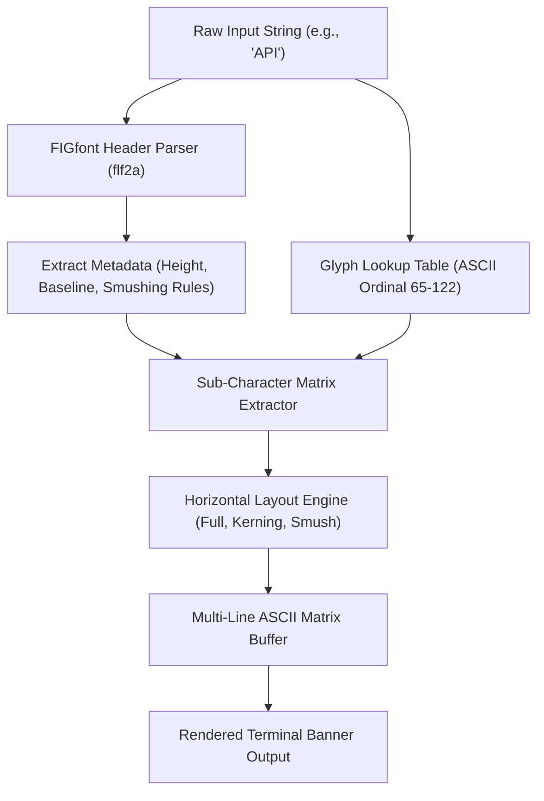

# ASCII Text Drawer: Online FIGlet & Banner Font Generator for Developers

## 1. Quick Overview & Key Benefits
The **ASCII Text Drawer** is a high-performance, developer-focused typography and ASCII art generator designed to transform plain text strings into stylized, multi-line ASCII and ANSI art banners. Powered by FIGlet and FIGfont standards, it enables systems engineers, DevOps practitioners, open-source maintainers, and command-line interface (CLI) authors to create distinctive visual banners for terminal applications, software splash screens, source code headers, MOTD (Message of the Day) notices, and code documentation.

### Core Value Proposition
- **Multi-Font FIGlet Engine**: Instantly render standard typography into dozens of iconic ASCII fonts, including `Standard`, `Slant`, `Doom`, `Ghost`, `Big`, `Small`, `Banner`, `Block`, and `Digital`.
- **Zero-Latency In-Browser Rendering**: Typographic layout generation and glyph mapping execute synchronously within your local runtime.
- **100% Client-Side Execution**: All string conversions, byte parsing, kerning computations, and character matrices are calculated entirely inside your client browser sandbox using JavaScript/WebAssembly.
- **Zero Server Transmission**: Your sensitive source code headers, private project names, internal server hostnames, and proprietary strings are **never** transmitted across the network or stored on any remote server.
- **Precision Spacing & Layout Controls**: Adjust letter spacing (kerning), horizontal smushing rules, line height, text orientation, and maximum banner width to prevent terminal word wrapping.

---

## 2. Step-by-Step Practical Usage Guide

### Basic Usage Workflow
1. **Input Source Text**: Enter your desired text string (alphanumeric characters, punctuation, or symbols) into the input field.
2. **Select FIGfont Family**: Choose an ASCII font suitable for your terminal width and visual density (e.g., `Standard` for universal shell banners, `Slant` for modern CLI tools, `Doom` for expressive visual titles).
3. **Configure Kerning and Smushing Rules**: Select between:
   - **Full Width**: Each glyph occupies its complete character box with maximum padding.
   - **Fitted (Kerning)**: Whitespace between adjacent glyph bounding boxes is eliminated until their non-blank characters touch.
   - **Smushing**: Adjacent overlapping characters are intelligently merged into single glyphs based on predefined linguistic and geometric rules.
4. **Copy Output**: Export the generated ASCII art banner directly to your clipboard as plain text, raw comment blocks for various programming languages (`/* ... */`, `//`, `#`, `"""`), or ANSI escape-coded output.

### Realistic Input & Output Examples

#### Example 1: Standard Font Banner
**Input Text**: `DEV-OPS`  
**Font**: `Standard`  
**Layout**: `Kerning / Fitted`

```text
 ____  _______     __     ___  ____  ____  
|  _ \| ____\ \   / /    / _ \|  _ \/ ___| 
| | | |  _|  \ \ / /____| | | | |_) \___ \ 
| |_| | |___  \ V /_____| |_| |  __/ ___) |
|____/|_____|  \_/       \___/|_|   |____/ 
```

#### Example 2: Slant Font Banner (CLI Tool Splash Screen)
**Input Text**: `KUBE-API`  
**Font**: `Slant`  
**Layout**: `Smushed`

```text
    __ ____  ______  ______       ___    ____  ____
   / //_/__ / __ )  / ____/      /   |  / __ \/  _/
  / ,<  / // / __  / __/ ______ / /| | / /_/ // /  
 / /| |/ // /_/ / / /___/_____// ___ |/ ____// /   
/_/ |_/___/____/ /_____/      /_/  |_/_/   /___/   
```

#### Example 3: Small / Mini Font (Source Code Header Comment)
**Input Text**: `AUTH V2`  
**Font**: `Small`  

```text
  _   _   _ _____ _   _  __     ______  
 / \ | | | |_   _| | | | \ \   / /___ \ 
/ _ \| | | | | | | |_| |  \ \ / /  __) |
/ ___ \| |_| | | | |  _  |   \ V /  / __/ 
/_/   \_\\___/  |_| |_| |_|    \_/  |_____|
```

---

## 3. Technical Under the Hood: Specifications & Architecture

### The FIGfont Standard (FIGlet Format Specification)
The underlying format powering terminal banner typography was standardized in the FIGfont Version 2 Specification (developed by Glenn Chappell and Ian Chai). A `.flf` (FIGlet Font File) is a pure ASCII text file containing header metadata followed by exact character matrix descriptors.



#### FIGfont Header Structure
Every conforming FIGfont begins with a magic header line:
```text
flf2a$ 6 5 20 15 3 0 143 229
```
Where the parameters represent:
- `flf2a`: Magic cookie designating FIGfont version 2.
- `$`: Hardblank character—a placeholder character (commonly `$` or `@`) rendered as an empty space in the final display but treated as non-blank during layout and smushing calculations.
- `6`: Height of each character cell in lines (rows).
- `5`: Baseline line index from the top of the character cell.
- `20`: Maximum character width in characters (columns).
- `15`: Old layout flags specifying kerning and smushing behaviors.
- `3`: Number of comment lines preceding character definitions.
- `0`: Print direction (`0` = Left-to-Right, `1` = Right-to-Left).
- `143`: Full layout flags (bitmask for 14 horizontal and vertical smushing modes).
- `229`: Codetag count for international characters.

### Sub-Character Matrices and Endmarks
Following comments, the font contains glyph descriptions for ASCII characters 32 through 126. Each row of a character is terminated by an endmark character (e.g., `@`), with the final row terminated by a double endmark (`@@`).

```text
  __ _ @
 / _` |@
| (_| |@
 \__,_|@
       @@
```

### Pure TypeScript FIGfont Parser & Line Smusher Engine
Below is an algorithmic implementation demonstrating how character rows are composited into multi-line strings with kerning support:

```typescript
export interface FigFontHeader {
  hardblank: string;
  height: number;
  baseline: number;
  maxLength: number;
  oldLayout: number;
  commentLines: number;
}

export class AsciiBannerRenderer {
  private header!: FigFontHeader;
  private glyphs: Map<number, string[]> = new Map();

  constructor(flfFileContent: string) {
    this.parseFont(flfFileContent);
  }

  private parseFont(content: string): void {
    const lines = content.split(/\r?\n/);
    const headerTokens = lines[0].split(/\s+/);
    
    this.header = {
      hardblank: headerTokens[0].slice(5, 6) || '$',
      height: parseInt(headerTokens[1], 10),
      baseline: parseInt(headerTokens[2], 10),
      maxLength: parseInt(headerTokens[3], 10),
      oldLayout: parseInt(headerTokens[4], 10),
      commentLines: parseInt(headerTokens[5], 10),
    };

    let lineIdx = 1 + this.header.commentLines;
    
    // ASCII standard characters range from 32 (space) to 126 (~)
    for (let charCode = 32; charCode <= 126; charCode++) {
      const charLines: string[] = [];
      for (let row = 0; row < this.header.height; row++) {
        let rawLine = lines[lineIdx++] || '';
        // Strip trailing endmarks (@ or @@)
        const cleanLine = rawLine.replace(/@+$/, '');
        charLines.push(cleanLine);
      }
      this.glyphs.set(charCode, charLines);
    }
  }

  public render(text: string, kerning: boolean = true): string {
    const outputRows: string[] = Array(this.header.height).fill('');
    
    for (const char of text) {
      const code = char.charCodeAt(0);
      const glyph = this.glyphs.get(code) || this.glyphs.get(32)!; // fallback to space

      for (let row = 0; row < this.header.height; row++) {
        let rowSlice = glyph[row].replace(new RegExp(`\\${this.header.hardblank}`, 'g'), ' ');
        if (!kerning) {
          rowSlice = rowSlice.padEnd(this.header.maxLength, ' ');
        }
        outputRows[row] += rowSlice;
      }
    }

    return outputRows.join('\n');
  }
}
```

### Horizontal Smushing Mechanics
FIGlet layout algorithms support controlled character overlapping ("smushing"). When two glyphs collide horizontally, smushing evaluates whether the touching characters can merge into a single character:
1. **Equal Character Smushing**: Two identical characters (e.g., `/` and `/`) merge into one.
2. **Underscore Smushing**: An underscore `_` can be replaced by `|`, `/`, `\`, `[`, `]`, `{`, `}`, `(`, or `)`.
3. **Hierarchy Smushing**: Evaluates symbol dominance in the hierarchy: `|` > `/\` > `[]` > `{}` > `()` > `<>`.
4. **Opposite Pair Smushing**: Symmetrical pairs such as `[]`, `{}`, or `()` merge into `|` or `0`.
5. **Big Slash Smushing**: `/` and `\` combine to produce `X`.
6. **Hardblank Smushing**: Two adjacent hardblank markers merge into a single hardblank.

---

## 4. Real-World Production Use Cases

### 1. Modern CLI Framework Initialization & Startup Splash Banners
Developers building command-line utilities in Go (Cobra), Rust (Clap), or Node.js (Commander/Oclif) integrate ASCII art banners to establish developer brand identity and display CLI versioning during `--help` or daemon initialization.

```go
package main

import "fmt"

const banner = `
   ___  ___ _____ ___ ___ _  _ ___ _    
  / _ \| _ \_   _|_ _| _ \ || | __| |   
 | (_) |  _/ | |  | ||  _/ __ | _|| |__ 
  \___/|_|   |_| |___|_| |_||_|___|____|
`

func main() {
    fmt.Println(banner)
    fmt.Println("OptiPhel Engine v4.12.0-RELEASE (x86_64-linux-gnu)")
    fmt.Println("Listening on unix:///var/run/optiphel.sock...")
}
```

### 2. Linux Server Message of the Day (MOTD) & SSH Login Notice
DevOps and Site Reliability Engineers (SREs) standardize corporate server fleets by embedding dynamic ASCII banners inside `/etc/motd` and `/etc/issue`. When administrators log in via SSH, the terminal immediately displays server cluster membership, environment tier (`PRODUCTION`, `STAGING`, `DR`), and regulatory compliance notices.

```bash
#!/bin/bash
# Dynamic SSH Banner Generator deployed via Ansible / Puppet
cat << "EOF"
  ____  ____   ___  ____       ____ _     _   _ ____ _____ _____ ____  
 |  _ \|  _ \ / _ \|  _ \     / ___| |   | | | / ___|_   _| ____|  _ \ 
 | |_) | |_) | | | | | | |   | |   | |   | | | \___ \ | | |  _| | |_) |
 |  __/|  _ <| |_| | |_| |   | |___| |___| |_| |___) || | | |___|  _ < 
 |_|   |_| \_\\___/|____/     \____|_____|\___/|____/ |_| |_____|_| \_\

 ALERT: Unauthorized access is strictly prohibited and logged!
 Environment: AWS-US-EAST-1 | Node: k8s-worker-prod-042
 Kernel: Linux 6.8.0-45-generic | Architecture: aarch64
EOF
```

### 3. Source Code Section Dividers & Architecture Documentation
Large monolithic files, low-level drivers, kernel modules, and complex configuration files utilize ASCII text banners inside comment blocks. This allows developers to visually locate code modules, lifecycle hooks, and architectural boundaries while scrolling rapidly through thousands of lines of code in IDEs like VS Code, Vim, or Neovim.

```typescript
// ============================================================================
//   ____  _____ _____ ___  ____  __  __    _    _   _  ____ _____ ____  
//  |  _ \| ____|  ___/ _ \|  _ \|  \/  |  / \  | \ | |/ ___| ____|  _ \ 
//  | |_) |  _| | |_ | | | | |_) | |\/| | / _ \ |  \| | |   |  _| | |_) |
//  |  __/| |___|  _|| |_| |  _ <| |  | |/ ___ \| |\  | |___| |___|  _ < 
//  |_|   |_____|_|   \___/|_| \_\_|  |_/_/   \_\_| \_|\____|_____|_| \_\
// ============================================================================
```

---

## 5. Frequently Asked Questions (FAQs)

### Q1: Why do some ASCII banners wrap or appear corrupted in smaller terminal windows?
Terminal emulators render monospace fonts within fixed column constraints (historically 80 or 120 columns). If the selected FIGfont generates an ASCII banner wider than the terminal's active `$COLUMNS` dimension, the terminal automatically wraps excess characters onto subsequent lines, breaking the spatial alignment. To resolve this, choose more compact fonts such as `Small`, `Mini`, or `Slant`, or dynamically detect terminal width using `tput cols` before printing.

### Q2: What is the difference between pure ASCII art and ANSI text art?
Pure ASCII art utilizes standard 7-bit ASCII characters (values 32 through 126), ensuring uniform display across any text file, terminal, IDE, or printer without specialized decoders. ANSI art extends this by embedding ANSI escape sequences (e.g., `\033[38;2;255;100;0m`), introducing 16-color, 256-color, or 24-bit TrueColor styling, cursor movements, and background shading.

### Q3: Does this generator send text strings to an external API or server?
No. The entire typography rendering pipeline—including `.flf` file parsing, character glyph matrix lookups, horizontal kerning calculations, and smushing logic—executes 100% within your local web browser sandbox. No text, telemetry, or metadata is ever transmitted over the network.

### Q4: How do I embed multi-line ASCII banners inside Python or Bash scripts without syntax errors?
In Python, encapsulate the output in raw triple quotes (`r"""..."""`) to prevent backslashes from being interpreted as escape sequences:
```python
BANNER = r"""
  _  ___   _ ____  _____ 
 | |/ / | | | __ )| ____|
 | ' /| | | |  _ \|  _|  
 | . \| |_| | |_) | |___ 
 |_|\_\\___/|____/|_____|
"""
```
In Bash, use a quoted `cat << "EOF"` heredoc block to prevent parameter expansion:
```bash
cat << "EOF"
  ____    _    ____  _   _ 
 | __ )  / \  / ___|| | | |
 |  _ \ / _ \ \___ \| |_| |
 | |_) / ___ \ ___) |  _  |
 |____/_/   \_\____/|_| |_|
EOF
```

---

## 6. Technical Accuracy & Client-Side Privacy Notice
- **Standards Compliance**: This tool strictly adheres to the **FIGfont Version 2 Specification** (`flf2a`), RFC 20 (7-bit ASCII character encoding), and POSIX terminal standards.
- **Client-Side Privacy Guarantee**: All rendering calculations, matrix adjustments, and string formatting operate completely offline in local browser memory. Zero external network requests are dispatched, guaranteeing absolute data confidentiality for proprietary identifiers, private keys, and internal infrastructure names.
