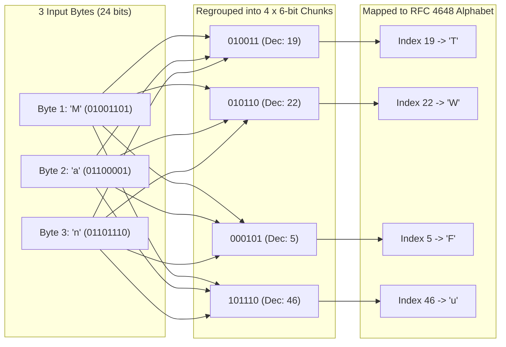

# Base64 File Converter: Binary-to-ASCII & Data URI Architecture Guide

## 1. Quick Overview & Key Benefits
The **Base64 File Converter** is an offline, zero-latency developer utility engineered to convert binary files (images, PDFs, audio, WebAssembly binaries, fonts, archives) into Base64-encoded ASCII strings, Data URIs, and raw byte arrays, as well as decode Base64 strings back into original binary files.

### Core Value Proposition
- **Binary-to-Text Standardization**: Seamlessly encode arbitrary binary payloads into standard 7-bit ASCII representations safe for transport across HTTP, JSON, XML, SMTP, and CSS.
- **Immediate Data URI Formatting**: Automatically detect MIME types and generate production-ready `data:[<mediatype>][;base64],<data>` strings for direct embedding into web pages and stylesheets.
- **100% Client-Side In-Browser Execution**: All file reading, stream parsing, and Base64 radix transformations run directly inside your client device's memory using the native HTML5 `FileReader` and `TypedArray` Web APIs.
- **Zero Server Transmission & Zero Data Retention**: Your binary files, confidential PDFs, certificate keys, and proprietary media are **never** uploaded to an external server or logged across a network connection.
- **Bidirectional Conversion**: Convert files to Base64 strings, or paste existing Base64 strings to inspect byte lengths, detect MIME types, and trigger automatic binary file downloads.

---

## 2. Step-by-Step Practical Usage Guide

### Encoding a File to Base64
1. **Select or Drop File**: Drag and drop any binary file (e.g., `favicon.ico`, `logo.svg`, `bundle.wasm`, `payload.bin`) into the file dropzone.
2. **Select Output Format**:
   - **Data URI**: Formatted as `data:<mime-type>;base64,<payload>` for HTML `` tags, CSS background rules, or web fonts.
   - **Raw Base64**: Pure ASCII string without metadata prefixes, suitable for JSON API payloads or database storage.
   - **Source Code Snippet**: Pre-formatted for JavaScript/TypeScript, Python, Go, or cURL requests.
3. **Copy or Export**: Copy the Base64 representation to the clipboard or export the text file.

### Decoding Base64 Back to File
1. **Paste Base64 String**: Paste a raw Base64 string or an entire Data URI into the input field.
2. **Inspect Metadata**: The tool evaluates the padding (`=`), calculates decoded byte size, and detects file signatures (magic bytes) such as PNG (`89 50 4E 47`), JPEG (`FF D8 FF`), or PDF (`25 50 44 46`).
3. **Download Decoded Binary**: Click "Download Decoded File" to generate an in-memory `Blob` and save the restored binary file directly to your disk.

### Realistic Input & Output Examples

#### Example 1: 1x1 Transparent PNG Spacer
**Input**: Binary `transparent.png` (68 bytes)  
**Output (Data URI)**:
```text
data:image/png;base64,iVBORw0KGgoAAAANSUhEUgAAAAEAAAABCAQAAAC1HAwCAAAAC0lEQVR42mNkYAAAAAYAAjCB0C8AAAAASUVORK5CYII=
```
**Output (Raw Base64)**:
```text
iVBORw0KGgoAAAANSUhEUgAAAAEAAAABCAQAAAC1HAwCAAAAC0lEQVR42mNkYAAAAAYAAjCB0C8AAAAASUVORK5CYII=
```

#### Example 2: Minimal SVG Vector Icon
**Input**: `vector.svg` (`<svg xmlns="http://www.w3.org/2000/svg" width="10" height="10"><circle cx="5" cy="5" r="5" fill="red"/></svg>`)  
**Output (Data URI)**:
```text
data:image/svg+xml;base64,PHN2ZyB4bWxucz0iaHR0cDovL3d3dy53My5vcmcvMjAwMC9zdmciIHdpZHRoPSIxMCIgaGVpZ2h0PSIxMCI+PGNpcmNsZSBjeD0iNSIgY3k9IjUiIHI9IjUiIGZpbGw9InJlZCIvPjwvc3ZnPg==
```

#### Example 3: Decoding Base64 in Bash / Linux Shell
```bash
# Encode file to Base64 on Linux/macOS
base64 -w 0 app-config.json > app-config.b64

# Decode Base64 string back to binary
echo "iVBORw0KGgoAAAANSUhEUgAAAAEAAAABCAQAAAC1HAwCAAAAC0lEQVR42mNkYAAAAAYAAjCB0C8AAAAASUVORK5CYII=" | base64 --decode > output.png
```

---

## 3. Technical Under the Hood: Specifications & Architecture

### RFC 4648 Specification & Mathematical Mechanics
Base64 encoding is standardized under **RFC 4648** ("The Base16, Base32, and Base64 Data Encodings"). Its fundamental purpose is translating arbitrary 8-bit octet sequences into an alphabet of 64 printable US-ASCII characters: `A-Z`, `a-z`, `0-9`, `+`, and `/`.



### The 24-Bit to 32-Bit Expansion & 33.3% Overhead
Because every 3 input bytes (24 bits) are subdivided into four 6-bit indices, Base64 creates four ASCII characters (32 bits):
$$\text{Size}_{\text{Base64}} = 4 \times \left\lceil \frac{\text{Size}_{\text{Binary}}}{3} \right\rceil$$

This introduces an unavoidable theoretical payload inflation of:
$$\frac{4 - 3}{3} \approx 33.33\%$$
When including Data URI prefixes or newline wrapping, total storage footprint increases by roughly 33% to 37%.

### Bit Padding Mechanics
When the total length of the binary input is not evenly divisible by 3:
- **Remainder of 1 byte (8 bits)**: The 8 bits are partitioned into one 6-bit chunk and one 2-bit chunk padded with four trailing zeros (`0000`). The remaining two 6-bit positions are filled with two ASCII equal signs (`==`).
- **Remainder of 2 bytes (16 bits)**: The 16 bits are partitioned into two 6-bit chunks and one 4-bit chunk padded with two trailing zeros (`00`). The final 6-bit slot is filled with one ASCII equal sign (`=`).

### High-Performance Browser Implementation via Uint8Array & FileReader
Below is a modern TypeScript implementation demonstrating binary file reading, streaming chunk processing, and Base64 conversion without memory-exhausting string concatenation:

```typescript
export interface ConversionResult {
  fileName: string;
  fileSize: number;
  mimeType: string;
  dataUri: string;
  rawBase64: string;
}

export class Base64FileProcessor {
  /**
   * Reads a File object locally and transforms it into Base64 using FileReader
   */
  public static async fileToBase64(file: File): Promise<ConversionResult> {
    return new Promise((resolve, reject) => {
      const reader = new FileReader();

      reader.onload = () => {
        const dataUri = reader.result as string;
        // Data URIs take the format: data:[<mediatype>][;base64],<data>
        const commaIndex = dataUri.indexOf(',');
        const rawBase64 = commaIndex !== -1 ? dataUri.substring(commaIndex + 1) : dataUri;
        const mimeType = file.type || 'application/octet-stream';

        resolve({
          fileName: file.name,
          fileSize: file.size,
          mimeType,
          dataUri,
          rawBase64,
        });
      };

      reader.onerror = (error) => reject(error);
      reader.readAsDataURL(file);
    });
  }

  /**
   * Decodes a Base64 string into a downloadable Blob with magic number detection
   */
  public static base64ToBlob(base64String: string, explicitMime?: string): Blob {
    // Strip Data URI prefix if present
    const cleanBase64 = base64String.replace(/^data:.*?;base64,/, '').trim();
    
    // Decode binary ASCII string
    const binaryStr = atob(cleanBase64);
    const len = binaryStr.length;
    const bytes = new Uint8Array(len);

    for (let i = 0; i < len; i++) {
      bytes[i] = binaryStr.charCodeAt(i);
    }

    const mime = explicitMime || this.detectMimeType(bytes);
    return new Blob([bytes], { type: mime });
  }

  /**
   * Magic number inspection to determine MIME type from raw byte headers
   */
  private static detectMimeType(bytes: Uint8Array): string {
    if (bytes[0] === 0x89 && bytes[1] === 0x50 && bytes[2] === 0x4E && bytes[3] === 0x47) {
      return 'image/png';
    }
    if (bytes[0] === 0xFF && bytes[1] === 0xD8 && bytes[2] === 0xFF) {
      return 'image/jpeg';
    }
    if (bytes[0] === 0x25 && bytes[1] === 0x50 && bytes[2] === 0x44 && bytes[3] === 0x46) {
      return 'application/pdf';
    }
    if (bytes[0] === 0x47 && bytes[1] === 0x49 && bytes[2] === 0x46) {
      return 'image/gif';
    }
    return 'application/octet-stream';
  }
}
```

---

## 4. Real-World Production Use Cases

### 1. Inlining Critical Web Assets to Eliminate HTTP Round-Trips
High-performance frontend architectures (e.g., Next.js, Vite, Webpack) inline critical above-the-fold assets—such as micro-icons, font subsets (WOFF2), or placeholder low-quality image previews (LQIP)—directly into CSS stylesheets or HTML documents as Base64 Data URIs.

```css
/* Critical UI Icon inlined to eliminate DNS lookup and TLS handshake */
.btn-search-icon {
  background-image: url("");
  width: 16px;
  height: 16px;
  display: inline-block;
}
```
*Advantage*: Completely avoids secondary network requests and eliminates layout shift (CLS) during page render.

### 2. Transmitting Binary Payloads Across JSON & gRPC REST Gateways
The JSON specification (RFC 8259) does not support native binary types; strings must conform to UTF-8/UTF-16 text. When client applications submit binary assets (e.g., biometric identity verification photos, cryptographically signed receipts, or encrypted blobs) to microservice REST APIs, the binary file is encoded to Base64 within the JSON envelope.

```json
{
  "transaction_id": "tx_9981240182",
  "document_type": "national_id_scan",
  "mime_type": "image/jpeg",
  "payload_base64": "/9j/4AAQSkZJRgABAQEASABIAAD/2wBDAP//////////////////////////////////////////////////////////////////////////////////////wgALCAABAAEBAREA/8QAFBABAAAAAAAAAAAAAAAAAAAAAP/aAAgBAQABPxA="
}
```

### 3. Storing Configuration Secrets & TLS Certificates in Kubernetes
Kubernetes `Secrets` store sensitive configuration elements such as private TLS keys (`tls.key`), certificate chains (`tls.crt`), and Docker registry credentials (`.dockerconfigjson`) as Base64 strings.

```yaml
apiVersion: v1
kind: Secret
metadata:
  name: edge-tls-secret
  namespace: ingress-nginx
type: kubernetes.io/tls
data:
  tls.crt: LS0tLS1CRUdJTiBDRVJUSUZJQ0FURS0tLS0t...
  tls.key: LS0tLS1CRUdJTiBSU0EgUFJJVkFURSBLRVkt...
```
DevOps engineers rely on Base64 file conversion to generate, inspect, and patch these declarative YAML manifests directly from disk certificates.

---

## 5. Frequently Asked Questions (FAQs)

### Q1: Does Base64 encoding encrypt or protect sensitive files?
**No.** Base64 is strictly an encoding algorithm, not an encryption cipher. It does not use cryptographic keys, and anyone with access to the Base64 string can decode it back to the exact original binary file in milliseconds. Never rely on Base64 for data confidentiality; sensitive files must be encrypted with AES-GCM or ChaCha20-Poly1305 before transmission.

### Q2: Why should I avoid embedding large images (> 50KB) as Base64 Data URIs?
While Data URIs eliminate HTTP requests, Base64 introduces a 33% payload size penalty. Furthermore:
1. Base64 strings inlined in HTML or CSS cannot be cached independently by browser HTTP caches.
2. The browser JavaScript engine and CSS parser must consume CPU cycles decoding the large Base64 string into memory.
3. It bloats initial DOM parse times. For assets larger than 10–20KB, serving standard binary files over HTTP/2 or HTTP/3 with appropriate `Cache-Control` headers is much faster.

### Q3: What is the difference between standard Base64 and URL-safe Base64?
Standard Base64 (RFC 4648 §4) uses `+` (index 62) and `/` (index 63). In URLs, query strings, and HTTP headers, `+` is often decoded as a space character, and `/` acts as a path delimiter. **URL-Safe Base64** (RFC 4648 §5) replaces `+` with `-` (hyphen) and `/` with `_` (underscore), and typically omits the trailing `=` padding characters.

### Q4: Are my uploaded files sent to your servers for processing?
**No.** The conversion process occurs entirely inside your web browser's local sandbox via the standard W3C `FileReader` and `TypedArray` APIs. No files, metadata, or strings ever traverse a network connection. You can disconnect your internet or inspect the browser's Network tab to confirm zero outgoing requests.

---

## 6. Technical Accuracy & Client-Side Privacy Notice
- **Standards Compliance**: This converter adheres strictly to **RFC 4648** (The Base16, Base32, and Base64 Data Encodings), **RFC 2397** (The "data" URL scheme), and W3C File API specifications.
- **Client-Side Privacy Guarantee**: All file ingestion, buffer transformations, and blob generations are executed client-side. No server-side components, analytics trackers, or external APIs are invoked.
