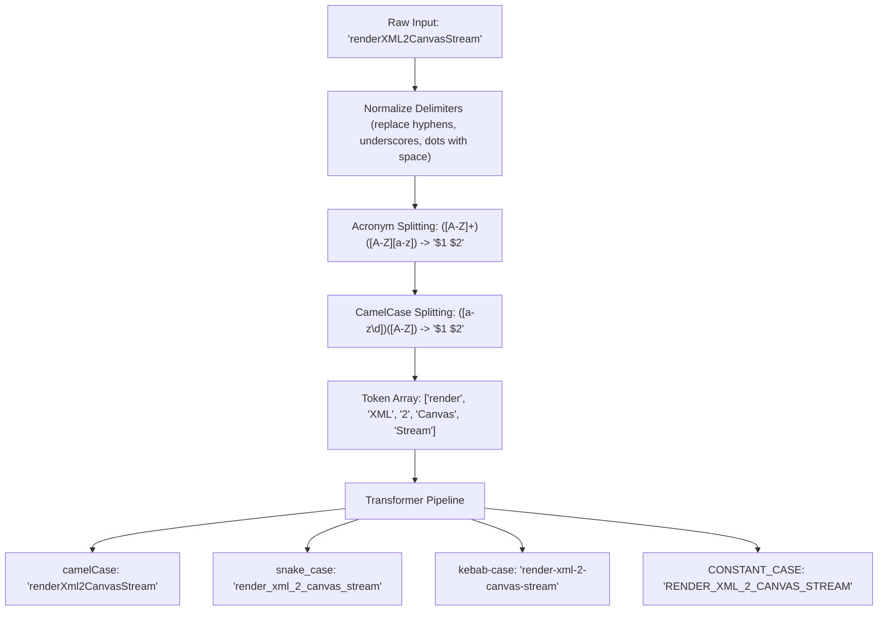

# Developer Case Converter: String Mutation & Multi-Language Naming Conventions

## 1. Quick Overview & Key Benefits
The **Case Converter** is a high-speed, client-side developer utility engineered to transform strings, identifiers, variable names, and multi-line datasets between various programming case conventions. Whether migrating database schemas, converting API payloads from snake_case to camelCase, or enforcing clean architectural standards across polyglot microservices, this tool handles string tokenization and lexical transformation instantly.

### Core Value Proposition
- **Comprehensive Case Support**: Convert effortlessly between `camelCase`, `PascalCase`, `snake_case`, `kebab-case`, `SCREAMING_SNAKE_CASE` (CONSTANT_CASE), `Train-Case` (HTTP Header Case), `Title Case`, `Sentence case`, `dot.case`, and `path/case`.
- **Intelligent Word Boundary Tokenization**: Accurately handles complex boundaries such as acronyms (e.g., `parseXMLString` $\rightarrow$ `parse_xml_string`), numeric transitions (`item12Value` $\rightarrow$ `item_12_value`), and mixed delimiters (`foo-bar_baz.qux`).
- **100% Client-Side In-Browser Execution**: All regex evaluations, token segmentations, and string mutations execute strictly inside your local browser JavaScript engine.
- **Zero Server Transmission**: Your sensitive source code identifiers, internal API schema models, and database columns remain entirely private—zero bytes are sent over the network.
- **Batch Multi-Line & JSON Key Processing**: Convert individual tokens, thousands of lines of raw text, or deep nested JSON objects with one click.

---

## 2. Step-by-Step Practical Usage Guide

### Basic Conversion Workflow
1. **Input Source Text**: Paste your string, code snippet, list of identifiers, or JSON payload into the input editor.
2. **Select Target Convention**: Choose your desired target format:
   - **camelCase**: Lowercase first word, uppercase subsequent words (`getUserProfile`).
   - **PascalCase**: Uppercase initial letter of every word (`UserProfileModal`).
   - **snake_case**: Lowercase words separated by underscores (`user_profile_data`).
   - **CONSTANT_CASE / SCREAMING_SNAKE_CASE**: Uppercase words separated by underscores (`MAX_RETRY_LIMIT`).
   - **kebab-case**: Lowercase words separated by hyphens (`user-profile-card`).
   - **Title Case**: Standard capitalized grammatical styling (`User Profile Settings`).
3. **Configure Parsing Options**:
   - **Preserve Numbers**: Control whether numbers trigger boundary splits (e.g., `v2Release` $\rightarrow$ `v2_release` vs `v_2_release`).
   - **Acronym Normalization**: Standardize sequences of capitals (e.g., `parseHTML` $\rightarrow$ `parse_html`).
4. **Copy Converted Result**: Instantly copy the transformed text or download the processed output.

### Realistic Input & Output Matrix

| Input String | camelCase | PascalCase | snake_case | kebab-case | CONSTANT_CASE |
| :--- | :--- | :--- | :--- | :--- | :--- |
| `userAuthenticationToken` | `userAuthenticationToken` | `UserAuthenticationToken` | `user_authentication_token` | `user-authentication-token` | `USER_AUTHENTICATION_TOKEN` |
| `get_http_status_code` | `getHttpStatusCode` | `GetHttpStatusCode` | `get_http_status_code` | `get-http-status-code` | `GET_HTTP_STATUS_CODE` |
| `DATABASE_MAX_POOL_SIZE` | `databaseMaxPoolSize` | `DatabaseMaxPoolSize` | `database_max_pool_size` | `database-max-pool-size` | `DATABASE_MAX_POOL_SIZE` |
| `render-svg-path-v2` | `renderSvgPathV2` | `RenderSvgPathV2` | `render_svg_path_v2` | `render-svg-path-v2` | `RENDER_SVG_PATH_V2` |
| `XMLHTTPRequestLoader` | `xmlHttpRequestLoader` | `XmlHttpRequestLoader` | `xml_http_request_loader` | `xml-http-request-loader` | `XML_HTTP_REQUEST_LOADER` |

---

## 3. Technical Under the Hood: Specifications & Architecture

### Tokenization & Boundary Detection Mechanics
The core challenge in case conversion lies not in string joining, but in **lexical boundary tokenization**. Naive splitting on whitespace or hyphens fails when encountering camelCase, consecutive uppercase acronyms, or digits.



### Production-Grade TypeScript Tokenizer & Case Engine
Below is a robust, production-grade implementation that resolves acronyms, alphanumeric transitions, and special characters cleanly:

```typescript
export class CaseConverter {
  /**
   * Splits any arbitrary identifier string into clean, lowercase semantic word tokens
   */
  public static tokenize(input: string): string[] {
    if (!input || typeof input !== 'string') return [];

    return input
      // Step 1: Insert space before capital letters preceded by lowercase letters or digits
      .replace(/([a-z0-9])([A-Z])/g, '$1 $2')
      // Step 2: Insert space between consecutive capitals followed by lowercase (acronyms like XMLParser)
      .replace(/([A-Z]+)([A-Z][a-z])/g, '$1 $2')
      // Step 3: Insert space around numeric boundaries if preceded by letters
      .replace(/([a-zA-Z])([0-9])/g, '$1 $2')
      .replace(/([0-9])([a-zA-Z])/g, '$1 $2')
      // Step 4: Replace any non-alphanumeric character (-, _, ., /, \) with spaces
      .replace(/[^a-zA-Z0-9]+/g, ' ')
      .trim()
      .split(/\s+/)
      .map((word) => word.toLowerCase());
  }

  public static toCamelCase(input: string): string {
    const tokens = this.tokenize(input);
    if (tokens.length === 0) return '';
    return tokens[0] + tokens.slice(1).map((t) => t.charAt(0).toUpperCase() + t.slice(1)).join('');
  }

  public static toPascalCase(input: string): string {
    return this.tokenize(input)
      .map((t) => t.charAt(0).toUpperCase() + t.slice(1))
      .join('');
  }

  public static toSnakeCase(input: string): string {
    return this.tokenize(input).join('_');
  }

  public static toKebabCase(input: string): string {
    return this.tokenize(input).join('-');
  }

  public static toConstantCase(input: string): string {
    return this.tokenize(input).join('_').toUpperCase();
  }

  public static toTitleCase(input: string): string {
    return this.tokenize(input)
      .map((t) => t.charAt(0).toUpperCase() + t.slice(1))
      .join(' ');
  }

  public static toTrainCase(input: string): string {
    return this.tokenize(input)
      .map((t) => t.charAt(0).toUpperCase() + t.slice(1))
      .join('-');
  }
}
```

### Deep JSON Object Key Recursive Mutation
A common engineering requirement is normalizing the keys of an entire JSON payload when integrating differing API standards:

```typescript
export function convertObjectKeys<T>(
  obj: any,
  converter: (key: string) => string
): any {
  if (Array.isArray(obj)) {
    return obj.map((item) => convertObjectKeys(item, converter));
  } else if (obj !== null && typeof obj === 'object') {
    const newObj: Record<string, any> = {};
    for (const [key, value] of Object.entries(obj)) {
      newObj[converter(key)] = convertObjectKeys(value, converter);
    }
    return newObj;
  }
  return obj;
}

// Example: Transforming a backend snake_case response into frontend camelCase
const backendResponse = {
  user_id: 1042,
  account_profile: {
    first_name: "Alice",
    last_login_epoch: 1718901234
  }
};

const frontendState = convertObjectKeys(backendResponse, CaseConverter.toCamelCase);
// Result: { userId: 1042, accountProfile: { firstName: "Alice", lastLoginEpoch: 1718901234 } }
```

---

## 4. Real-World Production Use Cases

### 1. Fullstack Schema Mapping: Python/PostgreSQL to TypeScript/React
Python (PEP 8) and PostgreSQL (SQL-92) mandate `snake_case` for variable names, functions, and relational column names (e.g., `user_account_id`, `created_at`). Conversely, JavaScript/TypeScript standards enforce `camelCase` for properties and `PascalCase` for React components and classes.
```python
# Python / SQLAlchemy Model
class UserAccount(Base):
    __tablename__ = "user_account"
    account_id = Column(Integer, primary_key=True)
    is_email_verified = Column(Boolean, default=False)
```
```typescript
// Transformed TypeScript Interface for Frontend React Components
export interface UserAccount {
  accountId: number;
  isEmailVerified: boolean;
}
```
Engineers use the case converter during code generation, ORM configuration, and schema migration to automate mapping between these idioms.

### 2. Rust Idiom Compliance: Converting C/C++ or Java APIs
The Rust compiler (`rustc`) issues strict warnings (`non_snake_case`, `non_camel_case_types`, `non_upper_case_globals`) when code violates Rust RFC 430:
- Types, Structs, Enums: `PascalCase` (UpperCamelCase)
- Functions, Methods, Modules, Variables: `snake_case`
- Constants and Statics: `SCREAMING_SNAKE_CASE`

When porting legacy C++ libraries or Java classes into Rust crates, developers run identifier batches through case converters to eliminate compiler warnings and generate idiomatic Rust bindings.

### 3. CSS Modules & Tailwind CSS Class Generation from Design Tokens
Design tokens defined in Figma or JSON configurations often use mixed or title conventions (e.g., `Primary Background Color`). Frontend engineers transform these into:
- CSS Custom Properties: `--primary-background-color` (kebab-case)
- Sass/SCSS Variables: `$primary-background-color`
- JavaScript Theme Constants: `PRIMARY_BACKGROUND_COLOR` (CONSTANT_CASE)
- TypeScript Typings: `PrimaryBackgroundColor` (PascalCase)

---

## 5. Frequently Asked Questions (FAQs)

### Q1: Why do acronyms like "XMLParser" or "HTML5Video" sometimes convert unpredictably?
Acronyms present ambiguous lexical boundaries. In `XMLParser`, three capital letters (`XML`) are followed immediately by another capital starting a new word (`P` in `Parser`). Without regex lookahead (`/([A-Z]+)([A-Z][a-z])/`), a naive parser might split this into `X`, `M`, `L`, `Parser` or treat `XMLP` as a single word. Our engine uses standard compiler tokenization heuristics to isolate `XML` and `Parser` accurately.

### Q2: What is the difference between kebab-case and Train-Case?
- **kebab-case** (also known as dash-case or spinal-case) uses all lowercase characters separated by hyphens (e.g., `content-security-policy`).
- **Train-Case** (often used in HTTP header conventions) capitalizes the initial letter of each word while preserving hyphens (e.g., `Content-Security-Policy`, `X-Rate-Limit-Remaining`).

### Q3: Is case conversion computationally safe for large text files and schemas?
Yes. Tokenization runs in linear time $O(n)$ relative to string length using optimized native JavaScript regular expressions. Transforming a 5,000-line database DDL dump or large API JSON schema takes only a few milliseconds inside modern V8 or SpiderMonkey engines.

### Q4: Does any data leave my browser during conversion?
**No.** All conversions execute entirely within your client-side browser runtime. No cookies, telemetry, or text payloads are sent to external web servers.

---

## 6. Technical Accuracy & Client-Side Privacy Notice
- **Language Standards Compliance**: This tool implements naming conventions following **Python PEP 8**, **Rust RFC 430**, **Google JavaScript/TypeScript Style Guide**, and **RFC 7230** (HTTP/1.1 Message Syntax & Headers).
- **Client-Side Privacy Guarantee**: Zero telemetry, zero analytics tracking, and zero network transmission. All operations occur strictly within local browser RAM.
