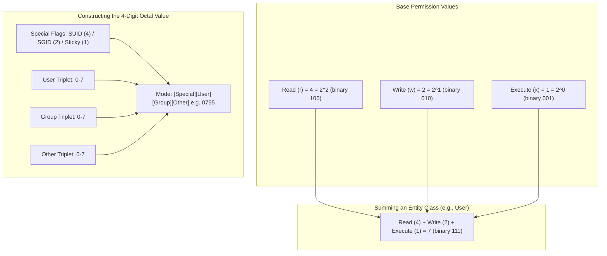

# POSIX Chmod Calculator: Linux File Permissions, Octal Modes & Umask Guide

## 1. Quick Overview & Key Benefits
The **Chmod Calculator** is an authoritative, interactive permissions calculator and decoder engineered for Linux administrators, DevOps engineers, systems programmers, and security auditors. It translates between numeric octal notations (e.g., `0755`, `0644`, `0400`), symbolic character strings (`rwxr-xr-x`), and special access flags (SUID, SGID, and the Sticky Bit) in strict alignment with POSIX.1-2017 standards.

### Core Value Proposition
- **Bidirectional Calculation**: Toggle interactive user, group, and other checkboxes to calculate octal numbers, or enter any 3-digit or 4-digit octal value to immediately visualize the permission bits.
- **Special Mode Flag Support**: Full support for SetUID (`4000`), SetGID (`2000`), and the Sticky Bit (`1000`), detailing their precise impact on security and process execution.
- **Umask Subtraction Engine**: Compute default file and directory creation permissions based on process umasks (`0022`, `0027`, `0077`).
- **100% Client-Side In-Browser Execution**: All permission computations, bitmask logical operations, and CLI syntax generators execute entirely inside your local web browser runtime.
- **Zero Server Transmission**: Your system architecture details, file path structures, and custom permission policies are never transmitted across the network.

---

## 2. Step-by-Step Practical Usage Guide

### Basic Calculation Workflow
1. **Define Target Scope**: Identify permissions across three POSIX entity categories:
   - **User / Owner (`u`)**: The user who owns the filesystem object.
   - **Group (`g`)**: The group that owns the filesystem object.
   - **Others / Public (`o`)**: All other system users not in the owner or group classes.
2. **Select Basic Permission Bits**:
   - **Read (`r` / `4`)**: Permits inspecting file contents or listing directory entries (`ls`).
   - **Write (`w` / `2`)**: Permits modifying/truncating file contents or creating/deleting directory entries.
   - **Execute (`x` / `1`)**: Permits executing binary programs/scripts or traversing into a directory (`cd`).
3. **Configure Special Modes (Optional)**:
   - **SUID (`4000`)**: Execute file with the file owner's privileges (e.g., `/usr/bin/passwd`).
   - **SGID (`2000`)**: Execute with group privileges, or inherit directory group ownership for newly created files.
   - **Sticky Bit (`1000`)**: Prevent non-owners from deleting or renaming files in shared directories (e.g., `/tmp`).
4. **Copy CLI Commands**: Instantly copy generated `chmod` shell commands formatted for Linux, macOS, and BSD environments.

### Standard Production Permission Matrix

| Octal | Symbolic Notation | Target Use Case | Detailed Access Description |
| :--- | :--- | :--- | :--- |
| `0644` | `-rw-r--r--` | Standard Data Files | Owner can read and write; group and others can only read. Safe default for web server static files. |
| `0755` | `-rwxr-xr-x` | Executables & Directories | Owner has full read, write, execute; group and others can read and execute/traverse. |
| `0700` | `-rwx------` | Private Admin Scripts | Only owner can read, write, and execute. Completely hidden from group and others. |
| `0600` | `-rw-------` | Sensitive Secrets & SSH Keys | Owner read/write only. Mandatory standard for SSH private keys (`~/.ssh/id_ed25519`). |
| `0777` | `-rwxrwxrwx` | **Security Hazard** | Full read, write, and execute for everyone on the system. Vulnerable to arbitrary code modification. |
| `1777` | `drwxrwxrwt` | Shared Temp Folders | World-writable sticky directory (e.g., `/tmp`). Anyone can create files, but only owners can delete them. |
| `2775` | `drwxrwsr-x` | Collaborative Shared Folders | SGID directory. New files automatically inherit the parent folder's group ownership. |
| `4755` | `-rwsr-xr-x` | SUID Binaries | Executed with the owner's system privileges regardless of which user launches it. |

---

## 3. Technical Under the Hood: Specifications & Architecture

### The POSIX.1-2017 Permission Bitmask Architecture
In Linux/Unix file systems (ext4, XFS, Btrfs, ZFS), file permissions are stored in the filesystem inode within a 16-bit integer field designated as `st_mode` (defined in `<sys/stat.h>`).

```text
 Inode st_mode bit layout (16 bits):
 +---+---+---+---+---+---+---+---+---+---+---+---+---+---+---+---+
 | File Type     | S | G | T |   User    |   Group   |   Other   |
 | (4 bits)      | U | I | K | r | w | x | r | w | x | r | w | x |
 +---+---+---+---+---+---+---+---+---+---+---+---+---+---+---+---+
                 | 4 | 2 | 1 | 4 | 2 | 1 | 4 | 2 | 1 | 4 | 2 | 1 |
```



### Mathematical Bitwise Operations in TypeScript
Below is an algorithmic implementation demonstrating how bitmasking decodes octal numbers into human-readable symbolic strings and verifies permission flags:

```typescript
export interface FilePermissions {
  octal: string;
  symbolic: string;
  suid: boolean;
  sgid: boolean;
  sticky: boolean;
  user: { read: boolean; write: boolean; execute: boolean };
  group: { read: boolean; write: boolean; execute: boolean };
  other: { read: boolean; write: boolean; execute: boolean };
}

export class ChmodEngine {
  private static readonly SUID_MASK = 0o4000;
  private static readonly SGID_MASK = 0o2000;
  private static readonly STICKY_MASK = 0o1000;

  private static readonly USER_READ = 0o0400;
  private static readonly USER_WRITE = 0o0200;
  private static readonly USER_EXEC = 0o0100;

  private static readonly GROUP_READ = 0o0040;
  private static readonly GROUP_WRITE = 0o0020;
  private static readonly GROUP_EXEC = 0o0010;

  private static readonly OTHER_READ = 0o0004;
  private static readonly OTHER_WRITE = 0o0002;
  private static readonly OTHER_EXEC = 0o0001;

  public static parseOctal(mode: number): FilePermissions {
    const suid = (mode & this.SUID_MASK) !== 0;
    const sgid = (mode & this.SGID_MASK) !== 0;
    const sticky = (mode & this.STICKY_MASK) !== 0;

    const uRead = (mode & this.USER_READ) !== 0;
    const uWrite = (mode & this.USER_WRITE) !== 0;
    const uExec = (mode & this.USER_EXEC) !== 0;

    const gRead = (mode & this.GROUP_READ) !== 0;
    const gWrite = (mode & this.GROUP_WRITE) !== 0;
    const gExec = (mode & this.GROUP_EXEC) !== 0;

    const oRead = (mode & this.OTHER_READ) !== 0;
    const oWrite = (mode & this.OTHER_WRITE) !== 0;
    const oExec = (mode & this.OTHER_EXEC) !== 0;

    // Build symbolic representation
    let userX = uExec ? 'x' : '-';
    if (suid) userX = uExec ? 's' : 'S';

    let groupX = gExec ? 'x' : '-';
    if (sgid) groupX = gExec ? 's' : 'S';

    let otherX = oExec ? 'x' : '-';
    if (sticky) otherX = oExec ? 't' : 'T';

    const symbolic = [
      uRead ? 'r' : '-',
      uWrite ? 'w' : '-',
      userX,
      gRead ? 'r' : '-',
      gWrite ? 'w' : '-',
      groupX,
      oRead ? 'r' : '-',
      oWrite ? 'w' : '-',
      otherX,
    ].join('');

    const octalPadded = mode.toString(8).padStart(4, '0');

    return {
      octal: octalPadded,
      symbolic,
      suid,
      sgid,
      sticky,
      user: { read: uRead, write: uWrite, execute: uExec },
      group: { read: gRead, write: gWrite, execute: gExec },
      other: { read: oRead, write: oWrite, execute: oExec },
    };
  }
}
```

### The Umask Subtraction Logic
When a Linux process creates a new file or directory using the `open(..., O_CREAT)` or `mkdir()` system calls, it specifies an initial base permission mode:
- **Default Base for Files**: `0666` (`rw-rw-rw-`) — execution bits are never enabled by default for security.
- **Default Base for Directories**: `0777` (`rwxrwxrwx`) — execution (traversal) is mandatory to enter directories.

The operating system kernel then applies a bitwise NOT-AND operation with the current process `umask`:
$$\text{Effective Mode} = \text{Base Mode} \ \& \ (\sim \text{Umask})$$

*Example with standard umask `0022` for a new file*:
$$\text{Base Mode}: 0666_8 = 110\ 110\ 110_2$$
$$\text{Umask}: 0022_8 = 000\ 010\ 010_2$$
$$\sim\text{Umask}: 7755_8 = 111\ 101\ 101_2$$
$$\text{Effective Mode}: 110\ 110\ 110_2 \ \& \ 111\ 101\ 101_2 = 110\ 100\ 100_2 = 0644_8 \ (\texttt{-rw-r--r--})$$

---

## 4. Real-World Production Use Cases

### 1. Hardening SSH Client Private Keys & Authorized Keys
The OpenSSH client strictly validates filesystem permissions before initializing any cryptographic handshake. If an SSH private key is readable by group members or other local users, SSH terminates with `Permissions 0644 for '/root/.ssh/id_rsa' are too open`:

```bash
# Secure SSH directory and cryptographic key pairs
chmod 0700 ~/.ssh
chmod 0600 ~/.ssh/id_ed25519
chmod 0644 ~/.ssh/id_ed25519.pub
chmod 0600 ~/.ssh/authorized_keys

# Validate permissions using stat command
stat -c "%a %A %n" ~/.ssh/id_ed25519
# Expected output: 600 -rw------- /root/.ssh/id_ed25519
```

### 2. Securing Web Servers (Nginx / Apache / PHP-FPM)
In web hosting environments, granting `0777` permissions to resolve upload errors exposes servers to remote code execution (RCE). The industry standard is separating file and directory modes:

```bash
# Navigate to web root
cd /var/www/html

# Directories require traverse (execute) bit: 0755
find . -type d -exec chmod 0755 {} +

# Static assets require read-only access for web server worker: 0644
find . -type f -exec chmod 0644 {} +

# Dedicated upload directory with restricted execution
chmod -R 0750 /var/www/html/storage/uploads
chown -R www-data:www-data /var/www/html/storage/uploads
```

### 3. Multi-User Team Collaboration Directories with SGID
When multiple developers or automated build pipelines share a common build artifact directory, files created by one engineer can default to their private user group, blocking other team members. Enabling the SetGID (`2000`) bit forces all newly created files to inherit the directory's group ownership:

```bash
# Create shared deployment directory
mkdir -p /opt/deployments
chown root:deployers /opt/deployments

# Set SGID (2) + Full User/Group permissions (77) + Read/Execute Others (5)
chmod 2775 /opt/deployments

# Verify SGID bit flag ('s' in group position)
ls -ld /opt/deployments
# Output: drwxrwsr-x 2 root deployers 4096 Sep 11 12:00 /opt/deployments
```

---

## 5. Frequently Asked Questions (FAQs)

### Q1: Why does directory execute permission (`x`) matter if I don't run directories as programs?
On POSIX filesystems, the execute bit (`x`) on a directory has a completely different semantic meaning than on a regular file. For directories, `x` grants **traversal permission**—the ability to `cd` into the directory, read file inodes within it, or access subdirectories. If a directory has read (`r`) permission without execute (`x`), a user can list the filenames inside it, but cannot view file sizes, inspect metadata, or open any files.

### Q2: What is the difference between uppercase 'S'/'T' and lowercase 's'/'t' in symbolic output?
The case of the special permission characters indicates whether the underlying standard execute (`x`) bit is also enabled:
- **Lowercase `s`**: SUID/SGID is active **AND** the execute bit (`x`) is active (`rws`).
- **Uppercase `S`**: SUID/SGID is active, but the execute bit (`x`) is **NOT** set (`rwS`), indicating a potential misconfiguration.
- **Lowercase `t`**: Sticky bit is active **AND** other execute is set (`rwt`).
- **Uppercase `T`**: Sticky bit is active, but other execute is **NOT** set (`rwT`).

### Q3: Why is `chmod 777` considered a critical security vulnerability?
Mode `0777` allows every local process and user on the system—including low-privilege service accounts (e.g., `nobody`, `daemon`) or compromised web application processes—to overwrite, truncate, corrupt, or append malicious scripts to the target file. If an executable or script is world-writable, any local attacker can achieve privilege escalation.

### Q4: Does chmod affect Windows filesystems (NTFS)?
Native Windows filesystems utilize Access Control Lists (ACLs) rather than POSIX octal modes. However, POSIX chmod notation applies directly when using Windows Subsystem for Linux (WSL), Git Bash, Docker containers running Linux, or SFTP/SCP clients communicating with remote Linux nodes.

---

## 6. Technical Accuracy & Client-Side Privacy Notice
- **Standards Compliance**: This calculator strictly conforms to the **IEEE Std 1003.1-2017 (POSIX.1)** specification for file access permissions, `chmod` utility syntax, and `<sys/stat.h>` bit definitions.
- **Client-Side Privacy Guarantee**: All calculations, bitmask operations, and command generations are computed directly within your web browser. Zero server logs, telemetry, or system information are transmitted.
